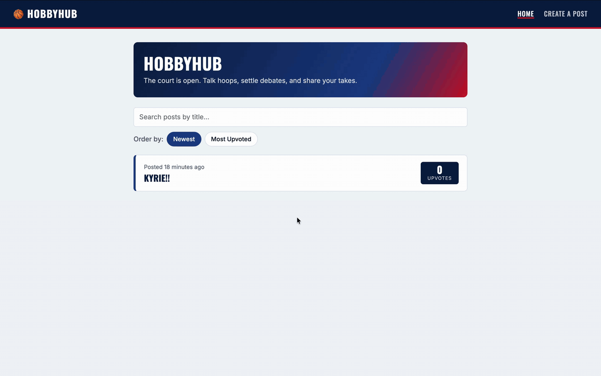

# Web Development Final Project - *HobbyHub*

Submitted by: **Austin Stanley Hinson**

This web app: **A basketball forum styled like a pro basketball broadcast, where fans share takes, upvote the ones they like, and argue about them in the comments. Posts are saved in a Supabase database. The home feed shows each post's time, title, and upvotes, and can be sorted by newest or most upvoted and searched by title. Each post has its own page with its content, image, upvote button, and comments. Posts are protected by a secret key set when posting, so only the author can edit or delete them, and any post can be reposted to start a thread.**

Time spent: **0** hours spent in total

## Required Features

The following **required** functionality is completed:

- [x] **Web app includes a create form that allows the user to create posts**
  - Form requires users to add a post title
  - Form should have the option for users to add additional textual content and an image added as an external image URL
- [x] **Web app includes a home feed displaying previously created posts**
  - Web app must include home feed displaying previously created posts
  - By default, each post on the posts feed should show only the post's creation time, title, and upvotes count
  - Clicking on a post should direct the user to a new page for the selected post
- [x] **Users can view posts in different ways**
  - Users can sort posts by either:
    - creation time
    - upvotes count
  - Users can search for posts by title
- [x] **Users can interact with each post in different ways**
  - The app includes a separate post page for each created post when clicked, where any additional information is shown, including:
    - content
    - image
    - comments
  - Users can leave comments underneath a post on the post page
  - Each post includes an upvote button on the post page.
    - Each click increases the post's upvotes count by one
    - Users can upvote any post any number of times
- [x] **A post that a user previously created can be edited or deleted from its post pages**
  - After a user creates a new post, they can go back and edit the post
  - A previously created post can be deleted from its post page

The following **optional** features are implemented:

- [x] Web app implements pseudo-authentication
  - Users can only edit and delete posts or delete comments by entering the secret key, which is set by the user during post creation
  - **or** upon launching the web app, the user is assigned a random user ID. It will be associated with all posts and comments that they make and displayed on them
  - For both options, only the original user author of a post can update or delete it
    - Each post gets a secret key when it's created. The edit page asks for the key before showing the form, and deleting asks for it too
    - The key is checked inside the database, and it can't be read through the API, so posts can't be changed without it
- [x] Users can repost a previous post by referencing its post ID
  - On the post page of the new post, the referenced post is displayed and linked, creating a thread
    - A Repost button on every post page opens the create form with that post's ID filled in
    - The original post also lists the posts that repost it, so the thread can be followed both ways
- [ ] Users can customize the interface
  - e.g., selecting the color scheme or showing the content and image of each post on the home feed
- [ ] Users can add more characteristics to their posts
  - Users can share and view web videos
  - Users can set flags such as "Question" or "Opinion" while creating a post
  - Users can filter posts by flags on the home feed
  - Users can upload images directly from their local machine as an image file
- [x] Web app displays a loading animation whenever data is being fetched
  - A spinning basketball, drawn with CSS, shows while posts, a single post, or comments are loading

The following **additional** features are implemented:

* [x] A navy, red, and white look inspired by pro basketball broadcasts, with scoreboard-style upvote counts on the feed
* [x] Comments appear right away after posting, and each shows how long ago it was written
* [x] Upvotes are added inside the database, so many fast clicks (or many people) never lose an upvote
* [x] Deleting a post also deletes its comments
* [x] Images that fail to load are hidden instead of showing a broken image
* [x] Friendly messages for an empty feed, searches with no matches, deleted posts, and pages that don't exist
* [x] The Supabase project URL and publishable key are kept in a `.env.local` file so they aren't committed to GitHub
* [x] The full database setup is saved in `supabase/schema.sql`

## Video Walkthrough

Here's a walkthrough of implemented user stories:

<!-- Replace this with whatever GIF tool you used! -->
GIF created with ...  
<!-- Recommended tools:
[Kap](https://getkap.co/) for macOS
[ScreenToGif](https://www.screentogif.com/) for Windows
[peek](https://github.com/phw/peek) for Linux. -->

## Notes

The hardest part was the secret key. My first thought was to save it as a normal column, but anyone can read every column through Supabase's API, so the key wouldn't really be secret, and anyone could still edit or delete posts directly. I hid the column from the API and removed the policies that let anyone update or delete posts. Edits and deletes now go through database functions that check the key first. That also broke upvoting, since it used to be a normal update, so I made the upvote function run with the table owner's permissions. Another challenge was upvotes in general: if the app read the count, added one, and saved it, two people clicking at the same time could overwrite each other, so the database adds the upvote itself. For reposts, I had to decide what happens when the original post is deleted, and I chose to keep the repost but drop its link.

## License

    Copyright 2026 Austin Stanley Hinson

    Licensed under the Apache License, Version 2.0 (the "License");
    you may not use this file except in compliance with the License.
    You may obtain a copy of the License at

        http://www.apache.org/licenses/LICENSE-2.0

    Unless required by applicable law or agreed to in writing, software
    distributed under the License is distributed on an "AS IS" basis,
    WITHOUT WARRANTIES OR CONDITIONS OF ANY KIND, either express or implied.
    See the License for the specific language governing permissions and
    limitations under the License.
